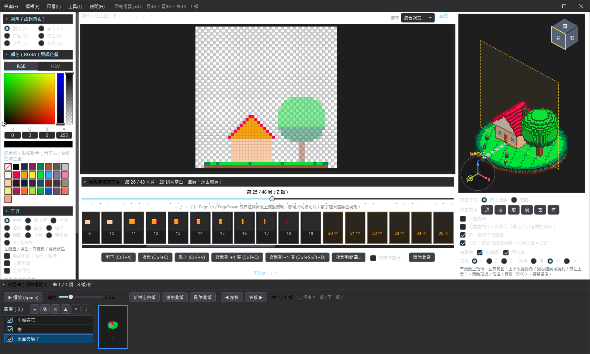

# PixelStacking

用 2D 切片一層一層「疊」出 3D 體素模型與動畫的編輯器（Voxel / Sprite Stacking），支援繁體中文、English、日本語、한국어。



*A voxel / sprite-stacking editor: draw a model slice by slice, see it live in 3D. UI languages: 繁體中文, English, 日本語, 한국어. English notes are at the bottom of this file.*

---

## 特色

- **一次畫一個切片**：像在畫像素畫一樣，從頂、底、前、後、左、右六個方向編輯，滑鼠左鍵畫、右鍵擦。
- **即時 3D 預覽**：右邊同步顯示。可選「實心體素」（光線投射，有光影與輪廓線）或「層疊」（Sprite Stacking 風格）；拖曳轉動、滾輪縮放；預覽有座標軸小圖、**視角方塊**與「頂／底／前／後／左／右」一鍵視角。
- **看得到自己在編輯哪一層**：預覽裡有黃色虛線框標出正在編輯的切片；也能「切開看內部」。
- **多圖層**（最多 64 層）：可把另一個 `.pstk` 當元件匯入成新圖層、用 **3D 魔術棒** 選取一塊體素後移動或抽到新圖層，像拼積木一樣組合模型。
- **完整的繪圖工具**：畫筆、橡皮擦、填滿、直線／矩形／橢圓、選取、魔術棒、吸管；11 種筆刷形狀（立方體、橢圓球、圓柱、圓錐、金字塔、圓環、螺旋…）；鏡像繪圖；選取區旋轉（Ctrl＋`[` / `]`）。
- **畫布倍率**：1×～64× 或自動適合視窗，放大後可用捲軸、滾輪、中鍵拖曳移動。
- **動畫**：多幀（1～30 fps），可逐幀編輯、複製、調整順序。
- **匯入圖片、膨脹**：把 2D 圖片轉成體素。
- **匯出**：PNG、GIF、疊層條帶（原本的 Sprite Stacking 格式），以及調色盤。
- **調色盤**：最多 255 色，RGB／HSV 選色，可清除沒用到的顏色、合併重複的顏色。
- **復原**：最多 200 步，包含筆畫、選取搬移、圖層與幀的增減。
- **給 AI 用的命令列 `pstk.exe`**：不開視窗，可以由 AI 或批次腳本建立與編輯模型（見下方）。

## 系統需求

- Windows 10（2018 年 4 月更新以後）或 Windows 11
- .NET Framework 4.7.2（上述 Windows 都已內建，一般不需另外安裝）

不需要安裝：解壓縮後直接執行 `PixelStacking.exe`。

## 資料夾內容

| 檔案 | 說明 |
|---|---|
| `PixelStacking.exe` | 主程式（雙擊執行） |
| `PixelStacking.exe.config` | 必須跟主程式放在同一個資料夾（含 .NET 版本與多螢幕縮放設定） |
| `pstk.exe` | 命令列版，給 AI／批次使用（選用） |
| `AI說明書.md` | `pstk.exe` 的完整說明，也可以在程式的「說明」選單裡複製給 AI 的提示詞 |
| `樣本\示範場景.pstk` | 示範模型：小島上的房子、樹與小徑（三個圖層），可以直接打開來玩 |

## 快速上手

1. 啟動程式，按 **Ctrl+N** 新增模型（例如 32×32×32；每個方向最多 128）。
2. 在左欄選顏色與工具，在中間畫布上畫。畫完一層，用 **← / →**（或 `[` `]`、PageUp／PageDown、層數滑桿）換到下一層。
3. 右邊的 3D 預覽會即時更新。拖曳轉動，滾輪縮放，雙擊還原；點視角方塊或「預覽視角」按鈕可以轉到正面、側面、頂面。
4. **Ctrl+S** 存成 `.pstk`（所有幀、圖層、調色盤都在裡面）。
5. 要給遊戲使用，從「檔案」選單匯出 PNG、GIF 或疊層條帶。

按 **F1** 可以打開程式內建的使用教學。

## 常用操作

| 操作 | 按鍵／滑鼠 |
|---|---|
| 新增／開啟／存檔 | Ctrl+N ／ Ctrl+O ／ Ctrl+S（另存 Ctrl+Shift+S） |
| 復原 | Ctrl+Z |
| 換層（切片） | ← → ／ `[` `]` ／ PageUp PageDown |
| 換視角 | 1～6（頂、底、前、後、左、右） |
| 工具 | I 吸管、L 直線、R 矩形、E 橢圓 |
| 複製到下一層／上一層 | Ctrl+D ／ Ctrl+Shift+D |
| 新增圖層 | Ctrl+Shift+N |
| 上一幀／下一幀 | `,` ／ `.` |
| 播放／暫停 | 空白鍵 |
| 畫布縮放 | 在畫布上按住 Ctrl 滾動滾輪，或用畫布上方的「倍率」選單 |
| 畫布捲動 | 滾輪（上下）、Shift＋滾輪（左右）、滑鼠中鍵拖曳 |
| 3D 預覽 | 拖曳轉動、滾輪縮放、雙擊還原 |

滾輪依游標位置分工：在畫布上＝捲動／縮放畫布；在「層數與複製工具」面板上＝換層；在右邊預覽欄＝縮放 3D 預覽；在左欄＝捲動功能列。

## 檔案格式

模型存成 `.pstk`（二進位）。這個格式會保存所有幀、圖層與調色盤；也保留舊版本的骨架與部件標記資料，所以舊檔仍然可以開啟。**請不要手動編輯 `.pstk`**，如果要用腳本或 AI 處理，請用 `pstk.exe`。

## 給 AI / 命令列：pstk.exe

`pstk.exe` 與主程式使用相同的核心，提供建立模型、畫形狀、匯入圖片、膨脹、圖層、魔術棒、渲染與匯出等指令：

```powershell
pstk help               # 所有指令
pstk manual             # 完整說明書（AI 應該先讀這個）
pstk info model.pstk    # 查看模型資訊
pstk render model.pstk out.png --yaw 45 --elev 35
```

做出來的 `.pstk` 可以隨時用主程式開啟（Ctrl+O）。完整說明請看 `AI說明書.md`。

## 已知限制

- 只支援 Windows。
- 每個方向最多 128 格、調色盤最多 255 色、最多 64 個圖層、動畫 1～30 fps。
- 預覽中的「層疊」模式俯角下限約 10°。

## 授權

以 [MIT 授權](LICENSE) 釋出，可自由使用、修改與散布，請保留版權與授權聲明。

---

# English

**PixelStacking** is a voxel / sprite-stacking editor for Windows. You draw a model one 2D slice at a time and watch it come together in a live 3D preview.

## Features

- Edit one slice at a time from six views (top, bottom, front, back, left, right).
- Live 3D preview: solid voxels (with shading and outlines) or stacked sprites; drag to rotate, wheel to zoom; axes gizmo, view cube and one-click view buttons; a dashed frame shows the slice you are editing.
- Up to 64 layers; import another `.pstk` as a layer, and pick up parts with the 3D magic wand to move them around like building blocks.
- Pencil, eraser, fill, line / rectangle / ellipse, selection, magic wand, eyedropper, 11 3D brush shapes, mirror drawing, selection rotation.
- Canvas zoom 1×–64× with scroll bars, wheel and middle-mouse panning.
- Multi-frame animation (1–30 fps), image import and inflate (turn a 2D picture into voxels).
- Export PNG, GIF and the classic stack-strip sprite sheet; palette up to 255 colours; 200 undo steps.
- UI in 繁體中文, English, 日本語 and 한국어 (Tools menu → Language).
- `pstk.exe`: a command-line version for AI agents and batch scripts. Run `pstk manual` for the full manual.

## Requirements and installation

Windows 10 (April 2018 Update or later) or Windows 11 with .NET Framework 4.7.2 (already included). No installer: unzip and run `PixelStacking.exe`. Keep `PixelStacking.exe.config` next to it.

## Quick start

1. **Ctrl+N** to create a model (up to 128 per axis).
2. Pick a colour and a tool, and draw on the middle canvas. Change slice with **← / →** (or `[` `]`, PageUp / PageDown).
3. Rotate the 3D preview by dragging; click the view cube to look from a side.
4. **Ctrl+S** saves a `.pstk`. Use the File menu to export PNG / GIF / stack strip.
5. Press **F1** for the built-in guide.

## Mouse wheel

Over the canvas: scroll up/down (Shift = sideways, Ctrl = zoom). Over the layer panel: change slice. Over the preview column: zoom the 3D preview. Over the left column: scroll the tool list.

## License

Released under the [MIT License](LICENSE).
